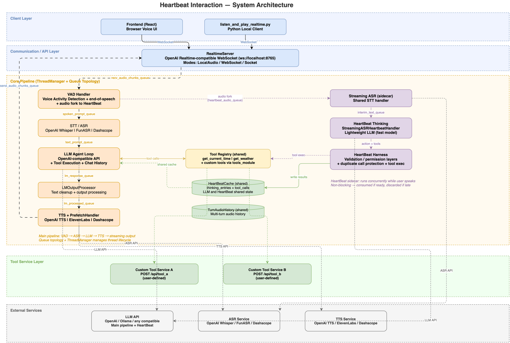
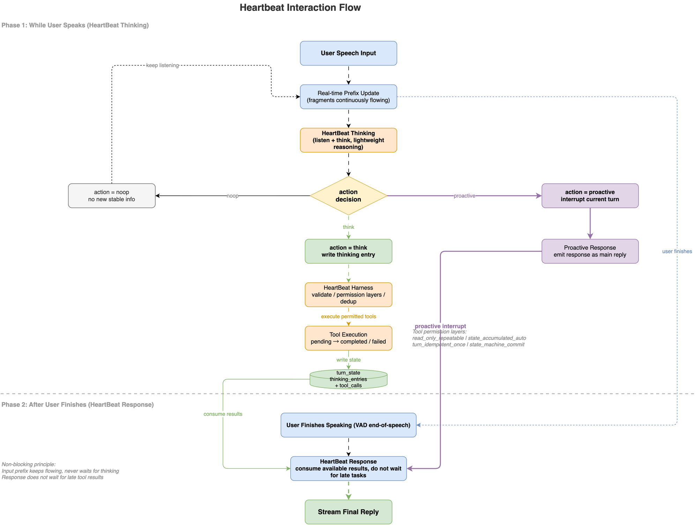

# ASRI Voice Agent - Heartbeat Interaction

[中文版本](README_cn.md)

ASRI Voice Agent is the voice interaction module for the ASRI intelligent dialogue service. It extends ASRI's text chat with a full end-to-end speech pipeline and implements Heartbeat Interaction: the system continuously receives audio segments while the user speaks, generates lightweight thinking entries online, and concurrently triggers tools when parameters stabilize. After the user finishes speaking, a Heartbeat Response consumes the completed thinking and tool results, streaming the final reply.

The voice UI is integrated into the ASRI frontend at the `/voice` route. This directory contains the voice backend pipeline only.

## Key Features

1. **Always-on**: Listen while thinking; execute tools concurrently when conditions stabilize.
2. **Non-blocking**: Heartbeat Thinking never blocks the user from continuing to speak, nor the final response.
3. **Extensible**: Query tools, idempotent side-effect tools, state-accumulation tools, and commit tools are all constrained differently at the Harness layer.
4. **Background sub-tasks**: Long-running tasks expose their latest state via a sub-task state zone, consumed on demand by the main pipeline.
5. **Full-duplex ready**: Thinking entries with `action=proactive` can escalate into a proactive response, ending the current turn and entering the main reply path.

## Architecture





## Pipeline

```text
Client audio / realtime input
    |
    v
VAD / ASR
    |
    +--> HeartBeat Thinking
    |       +--> thinking entries
    |       +--> optional concurrent tools
    |
    v
LLM Agent Loop
    |
    +--> server-side tools
    |
    v
TTS
    |
    v
Streaming Response
```

The server executes tool calls; the client only sends audio/text input and consumes streaming output.

## Key Directories

| Path | Description |
|---|---|
| `asri_voice/main.py` | End-to-end voice pipeline entry point |
| `asri_voice/pipeline/` | Queue topology, handler registry, cancel control, TTS prefetch |
| `asri_voice/handlers/stt/` | ASR handlers (OpenAI Whisper, FunASR, Dashscope, ElevenLabs) |
| `asri_voice/handlers/llm/` | OpenAI-compatible LLM handler, agent loop, tool execution |
| `asri_voice/handlers/tts/` | TTS handlers (OpenAI TTS, ElevenLabs, Dashscope, etc.) |
| `asri_voice/handlers/allm/` | Omni/ALLM handler (audio-native LLM entry point) |
| `asri_voice/handlers/heartbeat_interaction/` | HeartBeat Interaction implementation |
| `asri_voice/tools/` | Server-side tool registration and schemas |
| `asri_voice/api/openai_realtime/` | OpenAI Realtime-compatible WebSocket layer |
| `configs/` | YAML configs and system prompts |

## Quick Start

### Prerequisites

- Python 3.10+
- [uv](https://docs.astral.sh/uv/) package manager

### Install Dependencies

```bash
cd voice
uv sync
```

### Configure

Set your LLM API key:

```bash
export OPENAI_API_KEY="<your-openai-api-key>"
```

The default `configs/asri-voice.yaml` reads `OPENAI_API_KEY` for both the main LLM pipeline and HeartBeat Thinking. Never commit real keys to the repository.

### Start the Voice Backend

```bash
uv run python asri_voice/main.py --config configs/asri-voice.yaml
```

### Start the Frontend

The voice UI is integrated into the ASRI main frontend. After starting the ASRI dev server, visit the `/voice` route:

```bash
cd ../frontend
npm run dev
# Visit http://localhost:5173/voice
```

The Vite dev server proxies `/v1/realtime` WebSocket requests to the voice backend.

## TTS Backends

| `--tts` | Description |
|---|---|
| `openai_tts` | OpenAI TTS API (`/v1/audio/speech`) — **default for open-source** |
| `elevenlabs_tts` | ElevenLabs cloud TTS |
| `dashscope_tts` | Alibaba Dashscope TTS |
| `qwen3_tts` | Qwen3-TTS / vLLM Omni backend |
| `qwen3_tts_streaming` | Qwen3-TTS with `stream=true` PCM streaming |
| `qwen3_local` | Local Qwen3-TTS backend (macOS MLX) |

The default TTS config is declared in `configs/asri-voice.yaml` under `tts_config`.

## Tools

The default tool set is registered via `asri_voice/tools/demo_tools.py`, which includes:

| Tool | Description |
|---|---|
| `get_current_time` | Returns the current time (mock) |
| `get_weather` | Returns weather info for a city (mock) |

Custom tools can be added by creating a new tools module and registering it in the YAML config under `tools_module`.

## Configuration

| Config | Purpose |
|---|---|
| `configs/asri-voice.yaml` | Main voice pipeline config (Heartbeat Interaction) |
| `configs/asri-voice.example.yaml` | Example config with all options documented |

CLI arguments take priority over YAML values, which take priority over dataclass defaults.

## Testing

```bash
uv run pytest
```

For a quick smoke test:

```bash
uv run pytest tests/test_heartbeat_thinking.py tests/test_tool_execution_harness.py
```

## Integration with ASRI

- **Backend**: `voice/` is an asyncio Python application with its own pipeline/handler architecture. When integrated with Django, it is invoked via `VoiceConsumer` in the ASRI backend (WebSocket bridge), sharing the same process on port 8000.
- **Frontend**: The voice UI lives at `frontend/src/components/Voice/`, accessible via the `/voice` route. The frontend proxies `/v1/realtime` WebSocket to the voice backend.
- **Standalone**: Voice can also run independently via `voice/start.sh` without Django, exposing its own WebSocket server on port 8765.

## Package Structure

`voice/` is a proper Python package (`asri-voice`) managed as part of the ASRI uv workspace:

```
asri-fram/
├── pyproject.toml        # uv workspace root (members=["voice"])
└── voice/
    ├── pyproject.toml    # name="asri-voice", hatchling build
    └── asri_voice/       # importable as `import asri_voice.xxx`
```

See the root `pyproject.toml` for workspace configuration.
