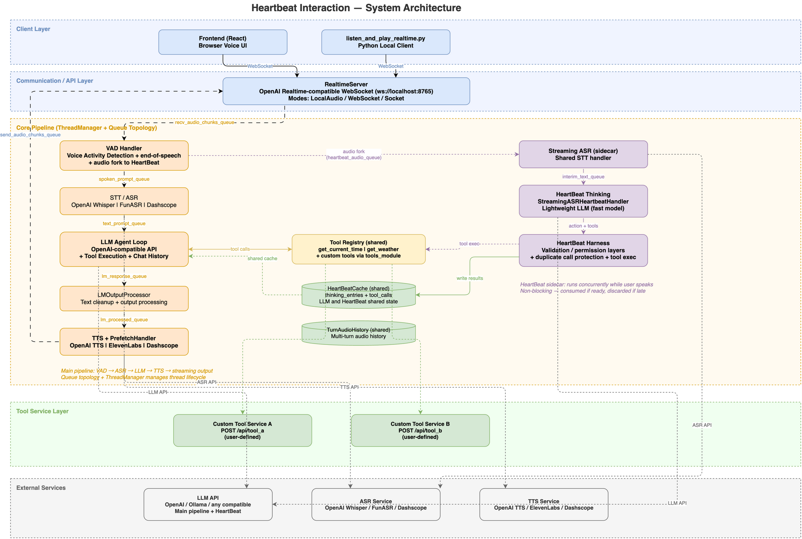
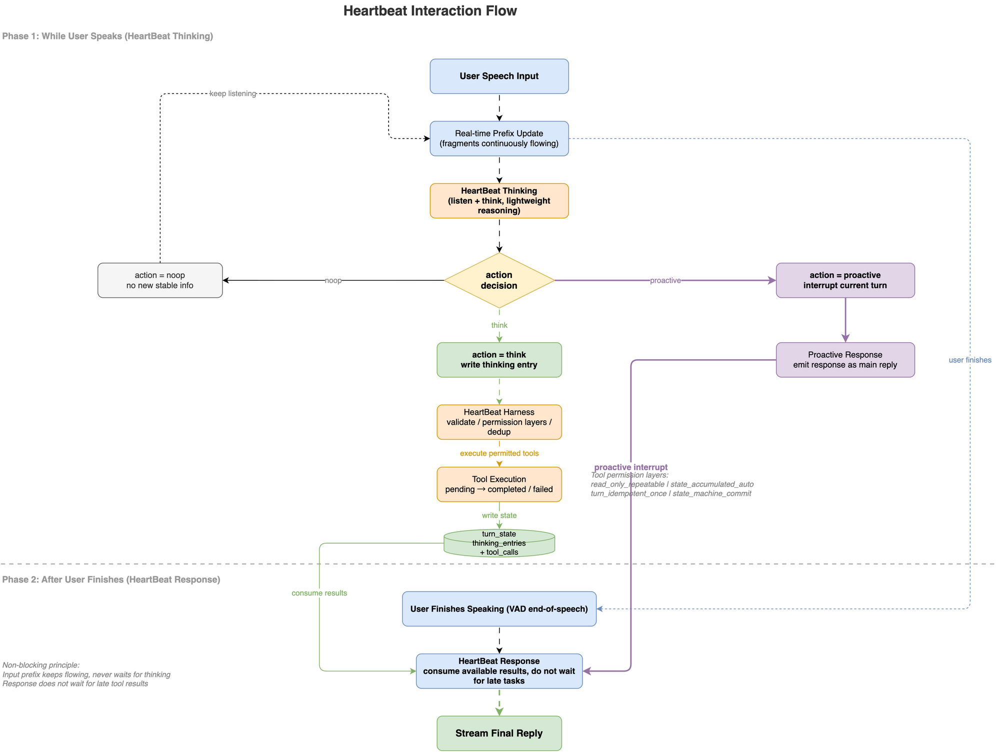

# ASRI Voice Agent - Heartbeat Interaction

[English Version](README.md)

ASRI Voice Agent 是 ASRI 智能对话机器人服务的语音交互模块。它在 ASRI 文本对话的基础上，提供完整的端到端语音 Agent 主链路，并实现 Heartbeat Interaction：用户说话过程中持续接收音频片段，系统在线生成轻量 thinking entry，在参数稳定时并发触发工具；用户说完后进入 Heartbeat Response，消费已完成的 thinking 和工具结果，流式生成最终回复。

前端语音交互界面已合入 ASRI 主前端，访问 `/voice` 路由即可使用。本目录仅包含语音后端 pipeline。

## 核心特点

1. **全程在线**：边听边想，条件稳定时并发执行工具。
2. **非阻塞**：Heartbeat Thinking 不阻塞用户继续说话，也不阻塞最终回复。
3. **可扩展**：查询工具、幂等副作用工具、状态累积型工具和提交型工具可在 Harness 层做不同约束。
4. **支持后台子任务**：长程任务通过子任务状态区暴露最新状态，主链路按需消费。
5. **面向全双工**：`action=proactive` 的 thinking entry 可升级为 proactive response，主动结束当前 turn 并进入主链路回复。

## 架构图





## 主链路

```text
Client audio / realtime input
    |
    v
VAD / ASR
    |
    +--> HeartBeat Thinking
    |       +--> thinking entries
    |       +--> optional concurrent tools
    |
    v
LLM Agent Loop
    |
    +--> server-side tools
    |
    v
TTS
    |
    v
Streaming Response
```

服务端负责执行工具调用，客户端只需要发送语音或文本输入并消费流式输出。

## 关键目录

| 路径 | 说明 |
|---|---|
| `asri_voice/main.py` | 端到端语音链路入口 |
| `asri_voice/pipeline/` | 队列拓扑、handler registry、取消控制、TTS prefetch 等主链路基础设施 |
| `asri_voice/handlers/stt/` | ASR handlers（OpenAI Whisper、FunASR、百炼、ElevenLabs） |
| `asri_voice/handlers/llm/` | OpenAI-compatible LLM handler、agent loop 和工具执行 |
| `asri_voice/handlers/tts/` | TTS handlers（OpenAI TTS、ElevenLabs、百炼等） |
| `asri_voice/handlers/allm/` | Omni/ALLM handler（音频原生 LLM 入口） |
| `asri_voice/handlers/heartbeat_interaction/` | HeartBeat Interaction 实现 |
| `asri_voice/tools/` | 服务端工具注册与 tool schema |
| `asri_voice/api/openai_realtime/` | OpenAI Realtime 兼容 WebSocket 层 |
| `configs/` | YAML 配置和 system prompt |

## 快速运行

### 前提条件

- Python 3.10+
- [uv](https://docs.astral.sh/uv/) 包管理器

### 安装依赖

```bash
cd voice
uv sync
```

### 配置

设置 LLM API Key：

```bash
export OPENAI_API_KEY="<your-openai-api-key>"
```

默认 `configs/asri-voice.yaml` 的 LLM 主链路和 HeartBeat Thinking 都读取 `OPENAI_API_KEY`。切勿将真实 key 提交到仓库。

### 启动语音后端

```bash
uv run python asri_voice/main.py --config configs/asri-voice.yaml
```

### 启动前端

语音 UI 已合入 ASRI 主前端。启动 ASRI 开发服务器后，访问 `/voice` 路由即可使用：

```bash
cd ../frontend
npm run dev
# 访问 http://localhost:5173/voice
```

Vite 开发服务器已配置 `/v1/realtime` 代理，将 WebSocket 请求转发到语音后端。

## TTS 后端

| `--tts` | 说明 |
|---|---|
| `openai_tts` | OpenAI TTS API（`/v1/audio/speech`）— **开源默认** |
| `elevenlabs_tts` | ElevenLabs 云端 TTS |
| `dashscope_tts` | 阿里百炼 TTS |
| `qwen3_tts` | Qwen3-TTS / vLLM Omni 后端 |
| `qwen3_tts_streaming` | Qwen3-TTS `stream=true` PCM 真流式输出 |
| `qwen3_local` | 本地 Qwen3-TTS 后端（macOS MLX） |

默认 TTS 配置在 `configs/asri-voice.yaml` 的 `tts_config` 中声明。

## 工具

默认工具集通过 `asri_voice/tools/demo_tools.py` 注册：

| 工具 | 说明 |
|---|---|
| `get_current_time` | 返回当前时间（mock） |
| `get_weather` | 返回城市天气信息（mock） |

自定义工具可通过创建新工具模块并在 YAML 配置的 `tools_module` 中注册。

## 配置

| 配置 | 用途 |
|---|---|
| `configs/asri-voice.yaml` | 主语音管线配置（Heartbeat Interaction） |
| `configs/asri-voice.example.yaml` | 示例配置，含所有可选项说明 |

配置值优先级：CLI 参数 > YAML > dataclass 默认值。

## 测试

```bash
uv run pytest
```

快速冒烟测试：

```bash
uv run pytest tests/test_heartbeat_thinking.py tests/test_tool_execution_harness.py
```

## 与 ASRI 主项目的关系

- **后端**：`voice/` 是 asyncio Python 应用，有独立的 pipeline/handler 架构。与 Django 集成时通过 `VoiceConsumer`（WebSocket 桥接）调用，共享 8000 端口。
- **前端**：语音交互界面位于 `frontend/src/components/Voice/`，通过 `/voice` 路由访问。前端将 `/v1/realtime` WebSocket 请求代理到语音后端。
- **独立运行**：Voice 也可通过 `voice/start.sh` 独立启动，暴露自己的 WebSocket 服务器（端口 8765）。

## 包结构

`voice/` 是一个标准的 Python 包（`asri-voice`），作为 ASRI uv workspace 的成员管理：

```
asri-fram/
├── pyproject.toml        # uv workspace 根（members=["voice"]）
└── voice/
    ├── pyproject.toml    # name="asri-voice"，hatchling 构建
    └── asri_voice/       # 可通过 `import asri_voice.xxx` 导入
```

详见根目录 `pyproject.toml` 的 workspace 配置。
